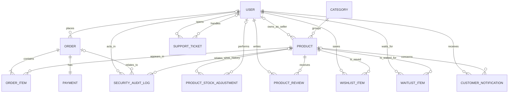
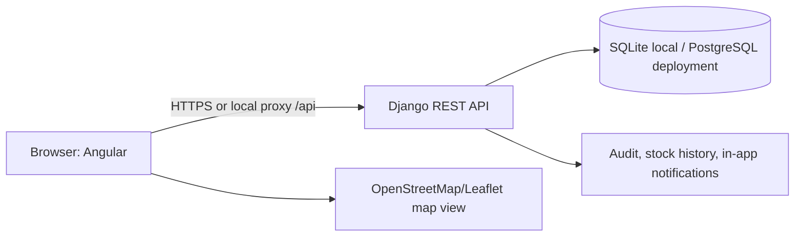

# OnlineShop requirements, design, and acceptance criteria

This document turns the project work areas into traceable requirements for the demonstration and future handover. It covers the secure e-commerce baseline plus the delivered account-control, feedback, PostgreSQL, support, wishlist, and waiting-list extensions.

## 1. Systems analysis and requirements

### Users and main use cases

| User | Problem to solve | Main use cases |
| --- | --- | --- |
| Buyer | Find products, save unavailable items, and buy without exceeding stock. | Browse/search/filter; manage cart; checkout; review/rate products; use wishlist/waitlist; view notifications; create own support tickets. |
| Seller | Maintain own listings while also using customer flows. | Create/update/deactivate owned listings; place orders; review/rate products; use saved lists and support. |
| Sales Manager | Operate customer orders and resolve service requests. | Apply valid order status transitions; view sales; triage/reply to support tickets. |
| Warehouse Staff | Prepare orders and reconcile physical inventory safely. | Adjust stock with a reason; view stock history; mark eligible orders as Preparing. |
| Head Manager | Assign ordinary work roles and understand business/support activity. | Create ordinary accounts; assign operational roles; see non-PII dashboard KPIs and support-ticket totals. |
| Security Manager | Protect ordinary accounts without becoming an unrestricted administrator. | Change only ordinary operational roles with a mandatory reason; activate/disable ordinary accounts; review audit activity; securely handle support tickets. |
| Database Administrator | Recover and operate the system in exceptional situations. | Protected break-glass access through Django superuser/administrator controls. |

### Delivered business rules

1. Public registration may create only a Buyer or Seller account.
2. A product has a unique non-empty SKU, positive price, active category, and non-negative stock.
3. Cart quantity is an integer from 1 through current stock. A zero-stock product cannot be added or ordered.
4. Checkout requires an authenticated Buyer or Seller, delivery address, permitted payment metadata, and at least one distinct product. It reserves stock, creates order/items/payment, or rolls back everything.
5. Warehouse stock adjustments require a meaningful reason and create immutable stock history plus an audit event.
6. Head Managers create/reassign only ordinary roles. Security Managers may also reassign only ordinary Buyer, Seller, Sales Manager, and Warehouse roles, but must record a reason and cannot edit themselves or protected accounts/roles. Security Managers can activate/disable those same ordinary accounts with a reason.
7. A customer has at most one review per product. Rating is an integer from 1 to 5; only its owner can edit/delete it, and public review data never exposes email/address.
8. Top products are ranked deterministically by average rating, review volume, then completed-order demand.
9. A wishlist is private to its owner. Saving an active zero-stock product automatically starts an active waiting-list alert; a customer can also explicitly join or leave a waiting list only while the product is unavailable.
10. When controlled inventory changes from zero to positive, each active waiting-list entry receives one in-app notification, then becomes inactive. The transaction locks relevant records to prevent duplicate restock notices. Cancelling a customer’s new order restores stock and preserves its products in that customer’s wishlist.
11. Client Support tickets are private to their customer. Customer accounts create/list their own tickets; authorised management, head-management, security, and administrator accounts can assign themselves, reply, transition status, and trigger a customer notification.
12. Full card numbers, CVC, expiry, and cardholder name are never accepted or stored by the API; the demo stores only card brand and last four digits.

### Acceptance criteria

- A customer completes catalogue → product detail → cart → validated checkout → order history in one session.
- Insufficient stock leaves both inventory and order records unchanged.
- Security Manager account changes require a reason, are audited, and cannot touch protected identities/roles.
- A customer can submit one 1–5 rating/review, see aggregate product rating, and see ranked top products.
- A zero-stock saved product appears in the customer’s waiting list; a zero-to-positive restock creates exactly one in-app notice per active waiter.
- A customer can create a support request, see only their own request, and receive an update after staff reply/triage.
- Catalogue searches, filters, sorting, and quantity controls respond on the first user action.
- A role cannot access protected UI routes or protected API endpoints outside its permission set.

## 2. Data and database design

### Entity relationship diagram

Purchase-time price is held on `OrderItem`, so reports remain correct after a catalogue price changes. Database constraints enforce valid roles/statuses, positive prices/quantities, non-negative stock, review ratings from 1–5, one product row per order, and unique user/product pairs for reviews, wishlist entries, and waitlist entries.

### PostgreSQL and large catalogue search

SQLite remains the no-setup local default. Setting `DATABASE_URL` switches Django to PostgreSQL; `psycopg` is included in the supported dependency set. The repository supplies `compose.postgres.yml` and an ignored local environment-file template so PostgreSQL can be provisioned reproducibly.

PostgreSQL migrations enable `pg_trgm`, add GIN trigram indexes for product name/description, and add functional `UPPER(...)` GIN indexes matching Django's case-insensitive `icontains` catalogue lookup. Additional composite indexes cover catalogue, order, review, waiting-list, notification, and support-ticket workflows. See [PostgreSQL deployment](POSTGRESQL_DEPLOYMENT.md) for the required extension privilege, local setup, TLS, query-plan verification, backups, and scale guidance.

## 3. Application and development

The Angular application supplies catalogue search/filtering/sorting, product detail, ratings/reviews, top-products ranking, cart quantity controls, checkout validation, wishlist/waiting list, notification centre, client-support workspace, seller listing management, operational dashboards, secure account management, audit views, profile/password tools, and responsive loading/error feedback.

The Django REST API is the final authority for all business rules. It validates orders again at checkout, protects every role-specific endpoint, uses database transactions for checkout/restock/support-critical state, and records material operational/security actions. The first-click change-detection issue was fixed by restoring the Angular zone-based change-detection runtime.

## 4. Architecture and security

### Current architecture

### Access and data protection

The UI hides irrelevant links and Angular guards reduce accidental navigation, while the backend independently checks every role. JWT access tokens are short lived; refresh tokens rotate and can be blacklisted on logout. Passwords are Django hashes and are write-only. Login/registration throttles, secure headers, active-account controls, reasoned and audited security actions, least-privilege permissions, and public-data minimisation reduce exposure.

Security Manager controls are deliberately bounded: the role can manage ordinary account roles/status but cannot edit its own account, Head Manager, Security Manager, or administrator accounts, and cannot grant protected roles. The Django administrator remains a separate protected recovery path.

## 5. Testing, analytics, and integration

- The automated Django system suite contains **59 passing tests**, including the previous core transaction/access coverage plus 39 new tests for security-role safeguards, reviews/ratings/top-products ranking, wishlist/waitlist ownership, restock notifications, cancellation preservation, client-support ownership/triage, and support dashboard KPIs. See [System test report](SYSTEM_TEST_REPORT.md).
- Angular build/unit checks and browser smoke checks validate the integrated screens and primary journeys.
- Angular and Django integrate through documented REST endpoints, JWT authorization, and a local development proxy. Leaflet/OpenStreetMap is limited to map presentation and does not receive application permissions.
- Head Managers receive business/support KPI counts; Sales Managers receive a 30-day product/revenue/units-sold report; Security Managers receive searchable audit activity; customers receive private in-app restock and support-update notifications.

## Future improvements

1. Replace demo card handling with a PCI-compliant provider using payment tokens and webhooks.
2. Add moderated reviews, abuse reporting, richer customer-feedback analytics, and recommendation features.
3. Add email/SMS/push delivery in addition to the current in-app notification centre.
4. Add CI, broader browser/UAT tests, load tests, support SLAs, and production monitoring/alerting.
5. Deploy behind a managed HTTPS domain with managed PostgreSQL, connection pooling, backup/restore drills, query-plan evidence, and capacity planning.
