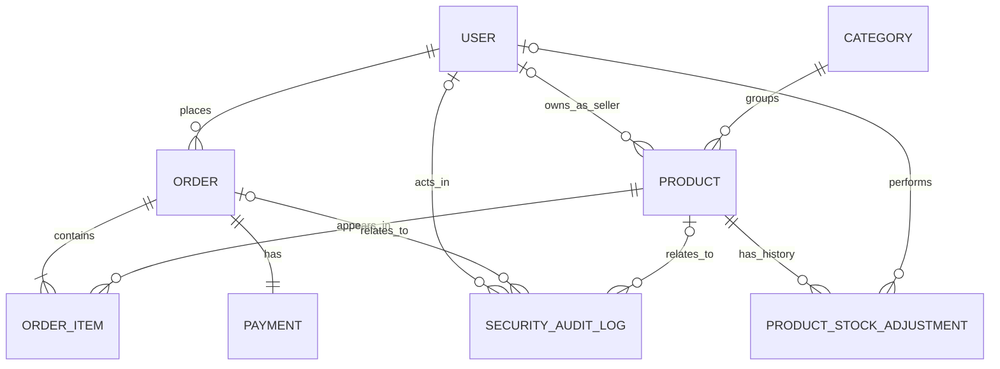
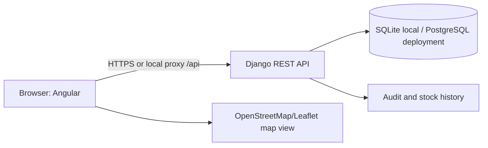

# OnlineShop requirements, design, and acceptance criteria

This document turns the project work areas into traceable requirements. It is written for a project demonstration and for future development handover.

## 1. Systems analysis and requirements

### Users and problems

| User | Problem to solve | Main use cases |
| --- | --- | --- |
| Buyer | Find reliable products and place an order without exceeding available inventory. | Browse, search, filter, view a product, manage cart quantities, checkout, view/cancel own new orders. |
| Seller | Maintain own catalogue listings without corrupting shared inventory. | Create a listing; update or deactivate only owned listings. |
| Sales Manager | Move customer orders through the delivery process and understand sales. | Review orders, apply valid status transitions, view 30-day sales report. |
| Warehouse Staff | Prepare eligible orders and reconcile physical stock safely. | Mark an eligible order as Preparing; adjust stock with a reason; review stock history. |
| Head Manager | Understand business activity and assign daily operational responsibilities. | Review non-PII KPIs; create ordinary staff accounts; assign operational roles. |
| Security Manager | Protect accounts and investigate significant activity without gaining business-control powers. | Search audit events; activate/deactivate ordinary accounts with a reason. |
| Database Administrator | Recover and operate the system in exceptional situations. | Protected full administrative access through Django superuser controls. |

### Core business rules

1. A public registration may create only a Buyer or Seller account.
2. A product must have a unique, non-empty SKU, positive price, active category, and non-negative stock.
3. A cart quantity is an integer from 1 up to the current available stock. A zero-stock product cannot be added.
4. Checkout requires at least one distinct product, a delivery address, permitted payment metadata, and a Buyer or Seller session.
5. Checkout updates stock, creates the order, order items, and payment record in one transaction. Any stock failure rolls back all partial changes.
6. Warehouse adjustments require a meaningful reason and create an immutable stock-history/audit record.
7. Order status transitions are controlled; warehouse preparation requires a paid card/bank order or cash-on-delivery eligibility.
8. Card checkout validates full details locally, but the API accepts only card brand and final four digits. PAN, CVC, expiry, and cardholder name are rejected and never stored.
9. Head Managers can assign only Buyer, Seller, Sales Manager, and Warehouse roles. Security Managers cannot change their own, leadership, security, or administrator accounts.

### Acceptance criteria

- A customer can complete catalogue → product detail → cart → validated checkout → order history in one session.
- Insufficient stock leaves both stock and order records unchanged.
- A role cannot access protected UI routes or protected API endpoints outside its permission set.
- A warehouse stock change shows an accountable reason and history record.
- Catalogue search, filtering, sorting, and quantity controls respond on the first user action.
- Security and operational audit events are searchable by the Security Manager.

## 2. Data and database design

### Entity relationship diagram



The main entities are `User`, `Category`, `Product`, `Order`, `OrderItem`, `Payment`, `ProductStockAdjustment`, and `SecurityAuditLog`. Purchase-time price is held on `OrderItem`, so reports remain correct after a catalogue price changes. One order has one payment record; an order can have many items.

### Data integrity and scale

- Database constraints enforce positive prices/quantities, non-negative stock, valid roles/statuses, payment method/status values, and one product row per order.
- Local development uses SQLite. A `DATABASE_URL` switches production to PostgreSQL without code changes.
- PostgreSQL uses `pg_trgm` GIN indexes for case-insensitive product name/description search, plus composite indexes for catalogue, stock, order-history, and order-status queries.
- See [PostgreSQL deployment](POSTGRESQL_DEPLOYMENT.md) for connection, TLS, migration, backup, and extension requirements.

## 3. Application and development

The Angular application supplies catalogue search/filtering/sorting, product detail, cart quantity controls, checkout validation, seller listing management, operational dashboards, account management, audit views, profile/password tools, and responsive feedback states.

The Django REST API is the final authority for data and rules. It validates orders again at checkout, protects every role-specific endpoint, and records material operational/security actions. The application provides loading indicators, success/error feedback, transitions, and reduced-motion support. The first-click change-detection issue was fixed by restoring the Angular zone-based change detection runtime.

## 4. Architecture and security

### Current architecture



### Recommended production network topology

```text
Browser → HTTPS reverse proxy / load balancer → Django application instances → managed PostgreSQL
                                             ↘ monitoring, backups, central logs
```

Secrets, database credentials, allowed hosts, CORS origins, TLS behavior, and debug mode are environment configuration—not source code. A production installation should use a managed PostgreSQL service, HTTPS, backups tested through restore, monitoring, and a PCI-compliant payment provider.

### Role and access control

The UI hides irrelevant links and Angular route guards reduce accidental access. More importantly, the backend checks roles independently. JWT access tokens are short lived; refresh tokens rotate and are blacklisted on logout. Passwords use Django hashes and policy validation. Login/registration throttles, secure response headers, active-account controls, audit records, least-privilege permissions, and data minimisation for warehouse output all reduce risk.

## 5. Testing, analytics, and integration

- The 20-case automated backend system suite validates transactions, stock, payment metadata safeguards, role enforcement, audit controls, fulfilment workflow, and session revocation. See [System test report](SYSTEM_TEST_REPORT.md).
- Angular build and unit checks validate frontend compilation and behavior; browser smoke checks cover the main user journey.
- Angular and Django integrate through documented REST endpoints, JWT authorization, and a local development proxy. Leaflet/OpenStreetMap provides map presentation without giving it access to application permissions.
- Sales Managers receive a 30-day product/revenue/units-sold report. Head Managers receive business KPIs such as revenue, order-status totals, active products, low-stock products, and active customers. Security Managers receive searchable operational/security audit events.

## Future improvements

1. Replace demo card handling with a PCI-compliant provider using payment tokens and webhooks.
2. Add email/SMS notifications for order changes and security events.
3. Add broader automated browser/UAT and load tests using realistic catalogue and order volumes.
4. Deploy behind a managed HTTPS domain with central monitoring, alerts, backup-restore drills, and database capacity planning.
5. Gather customer/staff usability feedback and convert it into prioritised user stories.
